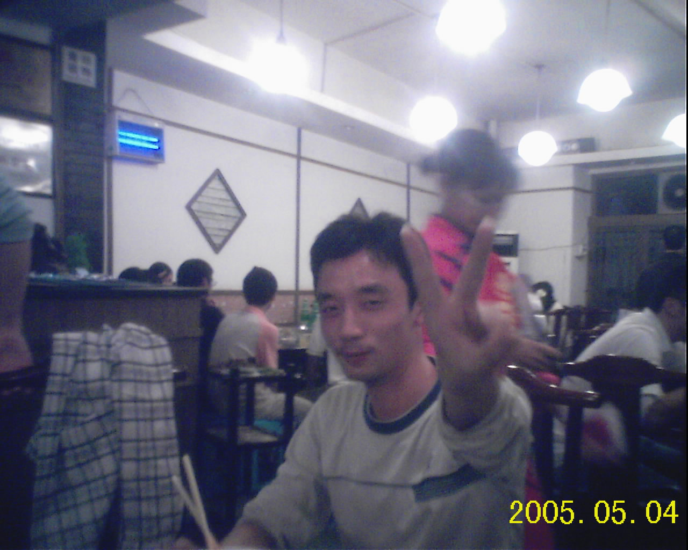
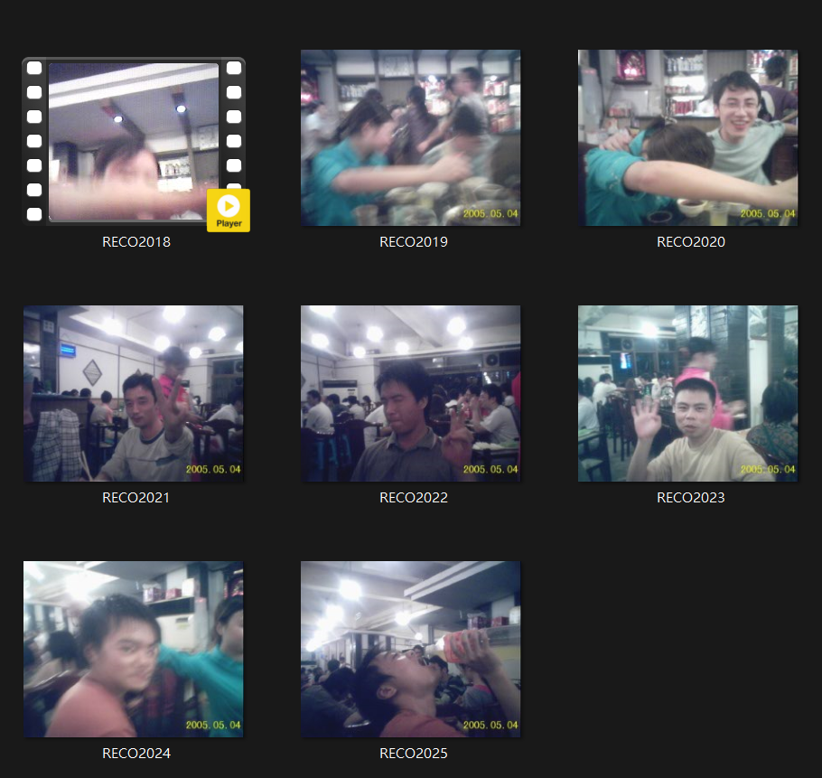
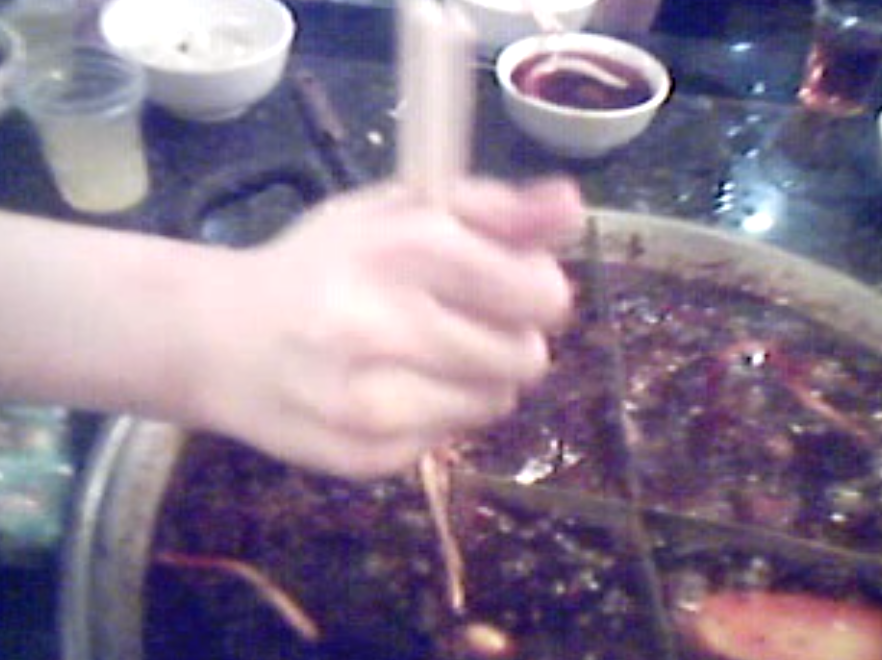

# 重慶沙坪壩的一次漢服圈聚會（相機日期 2005-05-04，存疑）

| 項目 | 內容 |
|---|---|
| 事件日期 | 相機資料顯示 2005-05-04；本人對日期存疑 |
| 類型 | 線下（重慶） |
| 地點 | 沙坪壩，重慶大學附近 |
| 我的角色 | 參與者 |
| 主要依據 | 本人回憶、照片、視頻 |

> **摘要：** 在重慶大學附近的一次聚會，應該是漢風請客吃火鍋。

## 一、我的回憶

【本人回憶｜2026-11-28 講述，經整理潤色】

那時候我常駐沙坪壩，經常去重慶大學的竹林，找行與子還、漢風、東方天空等人聊天。

這次聚會在沙坪壩的重慶大學附近，應該是漢風請客吃飯，我們吃的是火鍋。拍攝者是漢風。

根據照片和視頻，這次聚會只有：漢風、潼莞、東方天空、隴上走劍、我、漢神，以及一位未能確認的人（應該是漢風的同學？）。其中漢風、潼莞、東方天空、隴上走劍都是重慶大學的。

## 二、日期存疑

【本人回憶與判斷】

日期來自相機，這也是我現存資料中最早的一份。但我懷疑這個日期，理由如下：

1. 視頻裡大家已經很熟悉，應該認識很久了，不像最早期的情景。
2. 根據照片判斷，隴上走劍與潼莞當時已經是情侶，應該是比較後期的事。
3. 漢神應該是從成都來重慶，住在我家裡。我和他第一次認識，應該是我去德陽孔廟祭孔和舉行冠禮那次。

### 各人記憶不一

我就日期問題詢問過一些人，沒有得到確定答案。浸月（重慶大學）回憶，我們認識的時間可能更早，好像是 2003 或 2004 年，大概率是 2004 年，感覺是在大二時認識的。這是浸月關於認識時間的記憶，不是這次聚會的日期。

大家的記憶並不一致。時間越久，越難還原當時的情況，這裡把不同說法記下來。

## 三、照片與視頻截圖

【本人保存的材料】圖中人物只依本人說明標註，不憑相貌辨認。圖片說明中的日期為相機日期（存疑）。

*圖 1：聚會原始照片（原檔名記錄為 RECO2021.JPG）。畫面右下角印有 2005.05.04。*

*圖 2：本人保存的檔案縮略圖：RECO2018 為視頻，RECO2019 至 RECO2025 為七張照片。*

*圖 3：視頻截圖，當天吃的火鍋。*

*圖 4：視頻截圖，拍攝者漢風（依本人說明）。他沒有照片，以截圖補充。*

## 四、相機資料

> 讀取：Claude｜日期：2026-11-28。讀取對象為圖 1 的圖檔。

| 項目 | 內容 |
|---|---|
| 拍攝時間（DateTimeOriginal） | 2005-05-04 12:27:43 |
| 檔案欄位時間（DateTime） | 2005-05-04 12:28:19 |
| 相機廠商欄位 | SUNPLUS TECHNOLOGY CO., LTD. |
| 相機型號欄位 | SPCA536 |
| 解析度 | 1280 × 1024 |
| 原檔名記錄 | RECO2021.JPG |
| 閃光燈欄位 | 0（未閃光） |
| 定位資料 | 未見定位欄位 |

相機資料和畫面上的日期一致，但兩者可能都來自相機時鐘，不能互相作為獨立佐證。如果拍攝時時鐘設定錯誤，兩處日期會一起出錯。其他六張照片只看到縮略圖，其日期印字與圖 1 相同；沒有讀取它們和視頻的原檔資料。

## 五、AI 考證：與倉庫已有記錄對照

> 整理：Claude｜日期：2026-11-28。只對照倉庫已有記錄。

- [2005-04-24 的帖子](../online/2005-first-hanfu-inquiry.md)中，本人仍在詢問哪裡可以買到漢服。它距相機日期只有 10 天。
- [論壇記錄](../online/forums-and-communities.md)中的天漢帳號註冊於 2005-05-27，晚於相機日期。註冊時間不代表認識各位網友的時間。
- 依本人回憶，認識漢神應該是在[德陽孔廟冠禮](2003-deyang-adulthood-ceremony.md)那次。如果這一點和相機日期都正確，冠禮就應早於 2005-05-04。冠禮日期目前待核。

**小結：** 前兩項使人有理由留意相機日期，但不能單獨證明日期錯誤。本文保留相機日期，並註明存疑。
