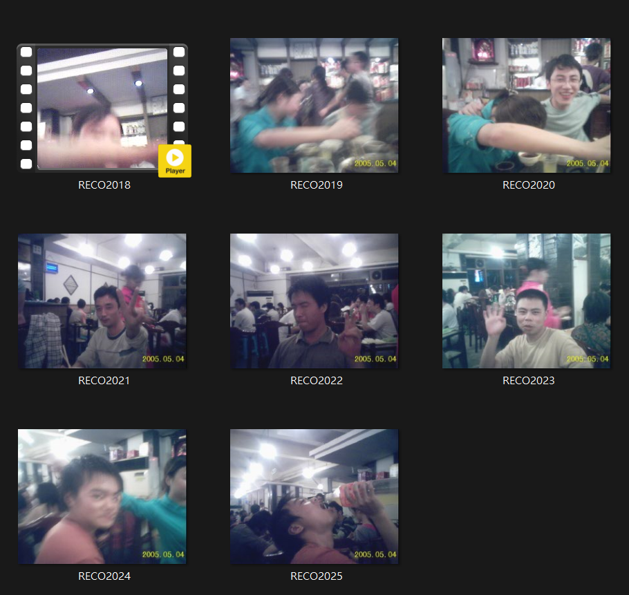
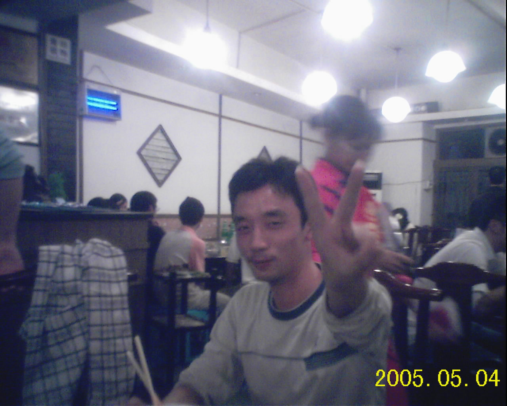
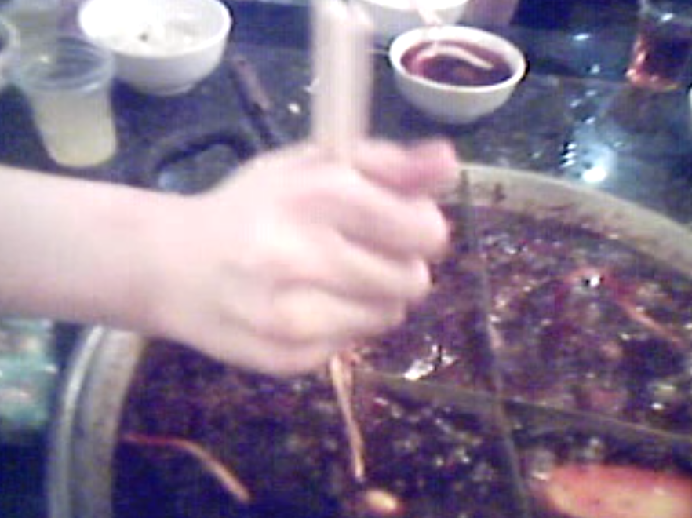

# 重慶沙坪壩的一次漢服圈聚會（約 2006 年 8、9 月）

| 項目 | 內容 |
|---|---|
| 事件日期 | 約 2006 年 8、9 月（推斷，具體日期未能確定）。相機顯示 2005-05-04，本人判斷此日期有誤 |
| 類型 | 線下（重慶） |
| 地點 | 沙坪壩，重慶大學附近 |
| 我的角色 | 參與者 |
| 主要依據 | 本人回憶、照片、視頻、他人回憶 |

> **摘要：** 在重慶大學附近的一次聚會，應該是漢風請客吃火鍋。

## 一、我的回憶

【本人回憶｜2026-11-28 講述，經整理潤色】

那時候我常駐沙坪壩，經常去重慶大學的竹林，找行與子還、漢風、東方天空等人聊天。

這次聚會在沙坪壩的重慶大學附近，應該是漢風請客吃飯，我們吃的是火鍋。拍攝者是漢風。

根據照片和視頻，這次聚會只有：漢風、潼莞、東方天空、隴上走劍、我、漢神，以及一位當時我未能確認的人（應該是漢風的同學？）。其中漢風、潼莞、東方天空、隴上走劍都是重慶大學的。

關於這一位，與漢風是同學的行與子還表示不認識。後來漢風說明了此人是誰，對方現在是漢風的親屬（姓名隱去）。

## 二、日期存疑

【本人回憶與判斷】

日期來自相機，這也是我現存資料中最早的一份。但我懷疑這個日期，理由如下：

1. 視頻裡大家已經很熟悉，應該認識很久了，不像最早期的情景。
2. 根據照片判斷，隴上走劍與潼莞當時已經是情侶，應該是比較後期的事。
3. 漢神應該是從成都來重慶，住在我家裡。我和他第一次認識，應該是我去德陽孔廟祭孔和舉行冠禮那次。

### 各人說法

【本人轉述｜2026-11-28 交流】我就日期問題詢問了一些人，以下是當天得到的回覆。引號內保留回覆文字。

**浸月**（重慶大學）回憶，我們認識的時間可能更早，好像是 2003 或 2004 年，大概率是 2004 年，感覺是在大二時認識的。這是浸月關於認識時間的記憶，不是這次聚會的日期。

**行與子還（子還）：**

起初回覆：「你那个照片日期不大对，见面应该是06年初」

之後進一步分析（依本人提供的聊天截圖抄錄；請客者姓名隱去，截圖不公開）：

> 子還：「从这个分析，〔姓名隐去〕请客的话，是不是〔姓名隐去〕上班后来请客？那就差不多是06年89月份了，看照片衣服也差不多」
>
> 我：「你們畢業了？」
>
> 子還：「我06年7月初就走了，我没在，那就应该是7月以后的」
>
> 我：「你們06年畢業？」
>
> 子還：「对」

**漢風：**

- 「06年第一次去朝天门买布料做汉服，3月参加花朝节活动。」
- 「我第一次参加活动是06年。」
- 「06年我没有数码相机。」

各人記得的時間並不完全一致。行與子還起初說「06年初」，之後經進一步分析，改為判斷在 7 月以後、差不多是 8、9 月。

### 目前判斷

【本人判斷｜2026-11-28 更新】基本可以確定相機日期是錯的。依子還的最新分析，這次聚會時間調整為約 2006 年 8、9 月；具體日期仍難以還原。

## 三、照片與視頻截圖

【本人保存的材料】圖中人物只依本人說明標註，不憑相貌辨認。圖片上和圖檔名稱中的 2005-05-04 是相機日期，本人判斷有誤；為便於對照原始資料，予以保留。

*圖 1：本人保存的檔案縮略圖：RECO2018 為視頻，RECO2019 至 RECO2025 為七張照片。*

*圖 2：聚會原始照片（原檔名記錄為 RECO2021.JPG）。畫面右下角印有 2005.05.04。*

*圖 3：視頻截圖，當天吃的火鍋。*

*圖 4：視頻截圖，拍攝者漢風（依本人說明）。他沒有照片，以截圖補充。*

## 四、相機資料

> 讀取：Claude｜日期：2026-11-28。讀取對象為圖 2 的圖檔。

| 項目 | 內容 |
|---|---|
| 拍攝時間（DateTimeOriginal） | 2005-05-04 12:27:43 |
| 檔案欄位時間（DateTime） | 2005-05-04 12:28:19 |
| 相機廠商欄位 | SUNPLUS TECHNOLOGY CO., LTD. |
| 相機型號欄位 | SPCA536 |
| 解析度 | 1280 × 1024 |
| 原檔名記錄 | RECO2021.JPG |
| 閃光燈欄位 | 0（未閃光） |
| 定位資料 | 未見定位欄位 |

相機資料和畫面上的日期一致，但兩者可能都來自相機時鐘，不能互相作為獨立佐證。如果拍攝時時鐘設定錯誤，兩處日期會一起出錯。其他六張照片只看到縮略圖，其日期印字與圖 2 相同；沒有讀取它們和視頻的原檔資料。

## 五、AI 考證：與倉庫已有記錄對照

> 整理：Claude｜日期：2026-11-28。只對照倉庫已有記錄。

- [2005-04-24 的帖子](../online/2005-first-hanfu-inquiry.md)中，本人仍在詢問哪裡可以買到漢服。它距相機日期只有 10 天。
- [論壇記錄](../online/forums-and-communities.md)中的天漢帳號註冊於 2005-05-27，晚於相機日期。註冊時間不代表認識各位網友的時間。
- [德陽孔廟冠禮](2005-10-29-deyang-coming-of-age.md)的日期為 2005-10-29，有本人次日發表的帖子佐證，比相機日期晚近六個月。本人回憶「應該」是在那次初次認識漢神；如果無誤，有漢神在場的這次聚會就應在冠禮之後。

**小結：** 倉庫記錄與漢風、行與子還的回覆，都指向比相機日期更晚的時間。其中漢風稱自己 2006 年才第一次參加活動；他出現在這次聚會是依本人說明。本文據此採納本人判斷，認為相機日期有誤。

月份主要來自子還的最新分析：他從請客者可能在上班後請客推想，認為差不多是 2006 年 8、9 月，並認為照片中的衣著也相合；他另表示自己 2006 年 7 月初已離開、聚會時不在場。「上班後請客」是他提出的推想，衣著也只能作為大致參考。他不在場的說法，是「7 月以後」這一判斷的依據之一。

這仍是推斷：相關回覆是事隔約二十年的回憶與分析，本節只對照倉庫記錄、本人轉述和聊天內容，未取得能直接確定聚會日期的同期材料。浸月所說的是認識時間。漢風表示 2006 年自己沒有數碼相機；拍攝所用相機屬於誰，目前沒有記錄。2026-11-28 另曾搜尋 2006 年重慶花朝節活動，本次查閱未找到相應的公開記錄，這不代表活動沒有舉行。
