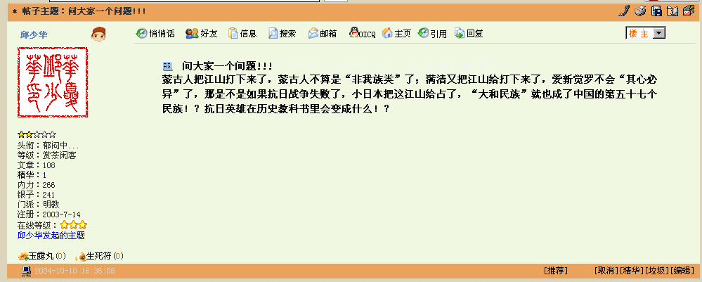

# 從金庸小說到漢服：我的歷史觀念形成與早期思考

## 一、最初的興趣：金庸武俠

【本人回憶】

小時候，我常看香港 TVB 拍攝的金庸武俠劇。那時候，對中國歷史與傳統文化的興趣，最初是從武俠故事開始的。

到了高中，我又接觸了網絡遊戲《金庸 Online》。遊戲曾經舉辦過一次活動，獎品是金庸小說。當時我參加了活動，但肯定沒有中獎。後來，我便自己花錢買了金庸小說全套。

閱讀金庸小說的過程，讓我開始對故事背後的歷史產生興趣。此後，我不再只是看武俠故事，也開始主動閱讀歷史，並在閱讀中逐漸形成自己的疑問和思考。

## 二、2004 年 10 月 10 日：留下文字記錄的歷史觀思考

【同期保存的論壇截圖】

目前能夠追溯到的一個早期文字記錄，是一張保存下來的論壇帖子截圖：

*圖：2004 年 10 月 10 日 16:36:08，帳號「邱少華」發表的論壇帖子。原始截圖由本人保存。*

- 帖子標題：**問大家一個問題！！！**
- 發帖日期：**2004 年 10 月 10 日**
- 發帖時間：**16:36:08**
- 發帖帳號：**邱少華**
- 帳號註冊日期：**2003 年 7 月 14 日**

截圖中提出的問題，涉及蒙古、滿清入主中原，以及如果日本在抗日戰爭中獲勝、佔領中國，後世又會如何理解民族身份與歷史評價。帖子最後追問：抗日英雄在歷史教科書中會變成什麼？

這段文字反映出，當時的我已經開始思考歷史敘述、民族身份與侵略者被納入後世歷史敘事之間的關係。它是目前保存下來、能夠看到我當時思考方式的一份直接材料。

【本人提供的原始帖子鏈接】

原帖網址：[金庸茶館論壇帖子](http://bbs.jycg.com.cn/dispbbs.asp?BoardID=5&ID=12329)。目前原頁已經失效，無法直接打開查看；但本人保留了這個原帖鏈接，並確認該網址就是金庸茶館論壇。因此，這張截圖所屬的論壇可確認為「金庸茶館」，不再列作待核實事項。

## 三、AI 考證：原帖網頁存檔

> 整理：Claude｜檢索日期：2026-11-26

以上述原帖網址查詢 Internet Archive 的 Wayback Machine 存檔查詢介面，本次沒有返回任何快照。這只代表該次以此網址查詢未找到，不代表原帖不存在，也不排除其他網址寫法或其他地方留有存檔。
